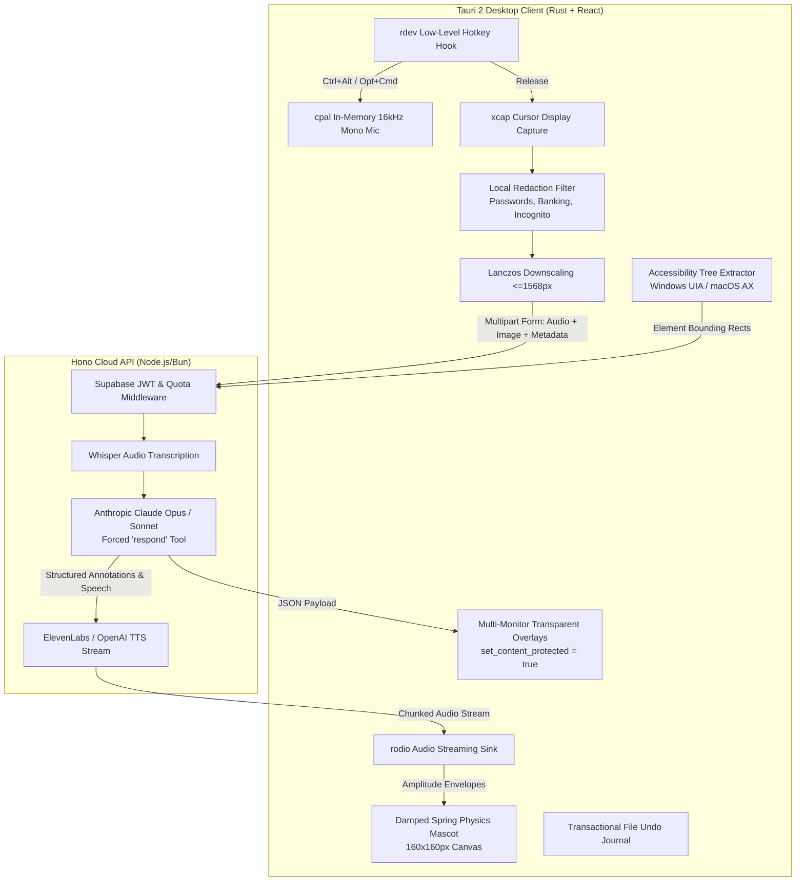

# Cursorbuddy Architecture & Subsystem Specification

## 1. System Overview & Philosophy

**Cursorbuddy** is an AI desktop companion built with Tauri 2, Rust, React, Hono, and Anthropic Claude.
Its foundational design principle is:
> **"Teaches, never clicks."**
> Cursorbuddy guides the user through complex user interfaces by speaking conversational guidance and drawing clear, non-intrusive SVG annotations over the relevant control, explaining *why* and *what* to do next. It never automates user clicks or executes destructive actions.

---

## 2. High-Level Architecture Diagram

---

## 3. End-to-End Interaction Pipeline

### 3.1 Push-to-Talk Lifecycle
1. **User presses and holds `Ctrl+Alt` (Windows) / `Option+Command` (macOS)**:
   - `rdev` hook thread detects the combination and emits `hotkey_down`.
   - Desktop client signals the mascot to transition from `idle` to `listening`.
   - `cpal` opens the default microphone, capturing 16 kHz mono PCM samples directly into an in-memory ring buffer.
   - Real-time RMS energy levels are emitted at 20 Hz to drive the mascot's pulsing waveform ring.
2. **User speaks their question and releases the hotkey**:
   - `rdev` hook detects key release and emits `hotkey_up`.
   - Audio capture halts; the ring buffer is encoded to an in-memory WAV container using `hound`.
   - The mascot transitions to `thinking`.
3. **Local Screen Capture & Pre-Upload Redaction**:
   - `xcap` queries the current cursor position $(x_{\text{cursor}}, y_{\text{cursor}})$ and captures only the monitor containing the cursor.
   - `RedactionFilter` enumerates all visible top-level windows on that monitor.
   - Any window matching sensitive criteria (password managers, banking keywords, incognito/private windows, or user blocklist) is painted with charcoal `#18181B` rectangles directly in the `RgbaImage` buffer.
   - The redacted frame is downscaled using Lanczos3 filtering such that $\max(W, H) \le 1568$ px.
   - The `resize_factor` is recorded, and the frame is encoded to JPEG (quality 85) in memory.
4. **Accessibility-Tree Control Extraction**:
   - If enabled, the native accessibility module (`uiautomation` on Windows, `ApplicationServices` on macOS) extracts visible interactive controls (buttons, tabs, menu items, inputs) within the active window.
   - Bounding boxes and element IDs are packaged into the request metadata.
5. **Backend Dispatch & LLM Evaluation**:
   - Desktop sends a multipart `POST /ask` request with `audio` (WAV), `image` (JPEG), and `metadata` (JSON) bearing the Supabase bearer token.
   - Backend transcribes audio via Whisper STT.
   - Backend calls Claude with `tool_choice: { type: "tool", name: "respond" }`.
   - The tool output is validated against the `@cursorbuddy/shared` Zod schema ($\le 3$ conversational sentences, no markdown, $\le 3$ annotations).
6. **Delivery & Visual Grounding**:
   - Spoken guidance is synthesized via TTS and streamed to the desktop's `rodio` sink.
   - Visual annotations are emitted to the transparent overlay on the corresponding monitor.
   - If an `element_id` matches an accessibility control, annotation coordinates snap to the native control bounds.
   - The mascot transitions to `speaking` (lip-syncing via TTS amplitude envelopes), points toward the primary target, and transitions to `happy` when complete.

---

## 4. Coordinate Transformation Mathematics

To ensure pixel-accurate alignment on multi-monitor setups with varying DPI scales, coordinates undergo a strict three-tier transformation:

$$\begin{aligned}
\text{Model Coordinates } (x_m, y_m, w_m, h_m) &\xrightarrow{/ \text{ resize\_factor}} \text{Physical Display Pixels } (x_p, y_p, w_p, h_p) \\
&\xrightarrow{/ \text{ scale\_factor}} \text{Webview CSS Pixels } (x_{\text{css}}, y_{\text{css}}, w_{\text{css}}, h_{\text{css}})
\end{aligned}$$

### Multi-Monitor Offsets & Signed Arithmetic
Each display has an origin $(X_{\text{origin}}, Y_{\text{origin}})$ in the virtual desktop coordinate space. Monitors situated to the left or above the primary monitor have negative origins:
$$X_{\text{global}} = X_{\text{origin}} + x_p, \quad Y_{\text{global}} = Y_{\text{origin}} + y_p$$
Each overlay window is pinned exactly to its respective monitor's physical bounds, meaning local webview coordinates are strictly monitor-relative:
$$x_{\text{css}} = \frac{x_m}{\text{resize\_factor} \times \text{scale\_factor}}$$

### Active Window Persistence (4 Hz Polling)
A background thread polls the active OS window at ~4 Hz (`GetForegroundWindow` / `NSWorkspace.frontmostApplication`):
- When the user switches away from the target window, overlay annotations fade out.
- When the user returns to the target window, annotations fade back in and automatically translate by $(\Delta x, \Delta y)$ if the window moved.

---

## 5. Anti-Capture & Click-Through Overlays

- **Click-Through**: Overlay webviews configure `window.set_ignore_cursor_events(true)`. On Windows, the window handle receives `WS_EX_TRANSPARENT | WS_EX_LAYERED | WS_EX_NOACTIVATE`. On macOS, `ignoresMouseEvents = true` is set.
- **Anti-Capture Protection**: Every overlay window invokes `window.set_content_protected(true)`.
  - On Windows: Sets `SetWindowDisplayAffinity(hwnd, WDA_EXCLUDEFROMCAPTURE)`.
  - On macOS: Sets `NSWindow.sharingType = NSWindowSharingNone`.
  This prevents Cursorbuddy's annotations from being captured in screenshots, eliminating recursive visual loops.

---

## 6. Dictation Mode

- Triggered by holding `Ctrl+Alt+Shift` (Windows) or `Option+Command+Shift` (macOS).
- Speech is recorded to RAM and posted to `/dictate`.
- The desktop saves existing clipboard contents via `arboard`.
- Transcribed text is placed onto the clipboard.
- Native keystrokes (`Ctrl+V` on Windows, `Cmd+V` on macOS) are simulated via `enigo`.
- After 50 ms (allowing the target application to accept the paste event), the user's prior clipboard text is restored.

---

## 7. Security, Privacy & Safety Invariants

1. **Zero-Disk Ephemeral Media**: Audio and screen captures exist only in RAM ring buffers and are freed immediately after transmission. No images or audio are stored on disk (except in explicit Debug Mode).
2. **Local Pre-Upload Redaction**: Password managers, banking sites, and private browsing sessions are blacked out on-device prior to network transmission.
3. **No Secrets in Client**: All third-party provider keys (Anthropic, OpenAI, ElevenLabs, Stripe, Supabase Service Key) reside exclusively on the Hono backend.
4. **Non-Destructive File Journal**: Background workflows never delete files. File moves and renames are recorded in a transactional journal supporting immediate one-click undo.
5. **Row-Locked Quotas**: Quotas are incremented atomically using PostgreSQL `FOR UPDATE` row locks, preventing race conditions and unauthorized use.
